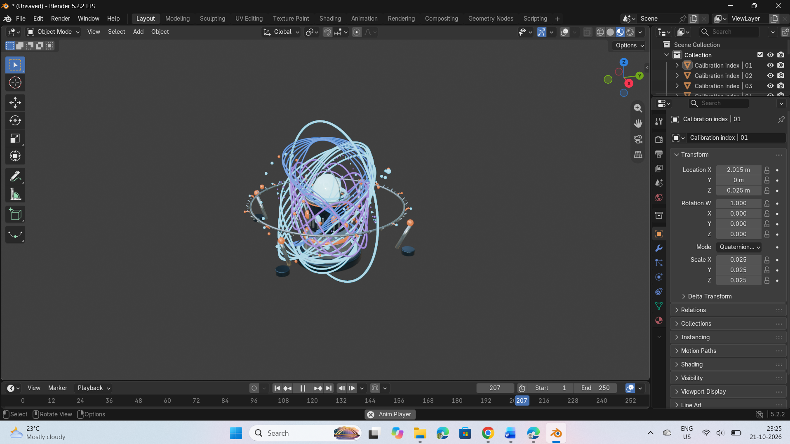

# FLUXFIELD
### A Study of Energy, Motion & Spatial Design

<p align="center">
  <strong>An exploration of scientific visualization through 3D design.</strong>
  <br />
  Geometry · Motion · Light · Spatial Composition
</p>

<p align="center">
  
</p>

<p align="center">
  
  
  
  
</p>

---

## 01. Overview

**FLUXFIELD** is an original 3D visualization project inspired by the structure and movement of an abstract scientific energy field.

Built around a central emitter, the composition combines concentric calibration rings, sweeping trajectories, metallic structures, and suspended particles. Cyan and violet accents establish a distinctive visual identity, balancing technical precision with an atmospheric, futuristic aesthetic.

The project explores how geometry, material contrast, lighting, and spatial hierarchy can transform a complex visual system into a cohesive experience.

> **Design direction:** Structure in motion. Energy in form.

## 02. The Visual Language

The visual identity of FLUXFIELD is built on a deliberate relationship between structure and movement.

| Design element | Purpose |
|---|---|
| **Central emitter** | Establishes the primary focal point |
| **Concentric rings** | Introduce precision, rhythm, and geometric order |
| **Curved trajectories** | Create visual direction and a sense of movement |
| **Cyan and violet accents** | Establish contrast and a futuristic color language |
| **Metallic surfaces** | Reinforce the technical, instrument-inspired aesthetic |
| **Floating particles** | Add atmosphere and a sense of spatial depth |

Each element contributes to the overall composition while maintaining a clear visual hierarchy.

## 03. Project Highlights

- **Spatial composition** — A central focal point supported by layered geometric structures.
- **Material exploration** — Metallic finishes contrasted with luminous color accents.
- **Geometric systems** — Interconnected rings and trajectories that create depth and rhythm.
- **Motion exploration** — Animation work developed around selected scene elements.
- **3D asset delivery** — A GLB export prepared for compatible 3D viewers and workflows.

## 04. Technology & Tools

| Component | Details |
|---|---|
| Primary tool | Blender |
| Asset format | glTF Binary (`.glb`) |
| Preview | PNG |
| Project category | 3D Scientific Visualization |
| Design focus | Geometry, materials, composition, and motion |

## 05. Preview the Asset

### 3D model

**[View or download FLUXFIELD.glb](./FLUXFIELD.glb)**

To explore the asset:

1. Download `FLUXFIELD.glb` from this repository.
2. Open it in Blender or another compatible glTF viewer.
3. Inspect the geometry, materials, and composition.
4. If the viewer supports animation, play the timeline and check the movement of individual elements.

**Animation compatibility:** The exported model should be tested in the target viewer to confirm that all intended animated elements play correctly. Animation behavior has not yet been fully validated across the complete export.

### Project preview

The `FLUXFIELD_PREVIEW.png` file provides a visual reference for the project and is displayed at the top of this README.

## 06. Repository Structure

```text
FLUXFIELD-3D-Asset/
├── FLUXFIELD.glb
├── FLUXFIELD_PREVIEW.png
└── README.md
```

The repository currently contains the exported 3D asset, its visual preview, and this documentation. The editable Blender source project is not currently included.

## 07. Design Process

The project follows a composition-first approach to 3D visual development.

**01 — Establish the focal point**

Build the composition around a central emitter to give the viewer an immediate visual anchor.

**02 — Introduce geometric structure**

Layer rings, trajectories, and surrounding elements to create depth, rhythm, and balance.

**03 — Develop the material language**

Use metallic surfaces and contrasting cyan-violet accents to distinguish structural and luminous elements.

**04 — Explore movement**

Experiment with coordinated animation across selected scene components.

**05 — Prepare the asset for export**

Export the scene to GLB format and identify areas requiring further compatibility and animation testing.

## 08. Further Development

Potential next steps for FLUXFIELD include:

- Validate animation playback across compatible 3D viewers.
- Refine export consistency and asset optimization.
- Add detailed renders and close-up visual studies.
- Include the editable Blender source project.
- Complete the community submission and review process.

## 09. About

FLUXFIELD was developed as part of the **Algoryx UI/UX Internship — Week 4: 3D Asset Creation & Algoryx Community Contribution**.

The project extends my design practice into 3D visualization, exploring how spatial composition, geometry, materials, and motion can work together to communicate a consistent visual concept.

It represents an ongoing exploration of digital design beyond conventional interface layouts.

---

<p align="center">
  <strong>FLUXFIELD</strong>
  <br />
  <sub>Structure in motion. Energy in form.</sub>
  <br /><br />
  Created by <a href="https://github.com/aeternum-core">AeternumCore</a>
</p>

<p align="center">
  <sub>Community publication status will be updated following the official review process.</sub>
</p>
